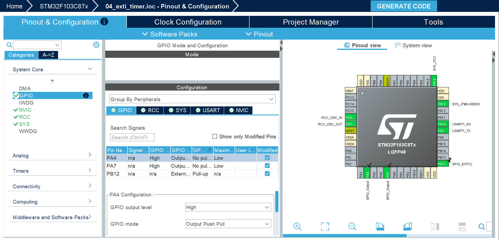
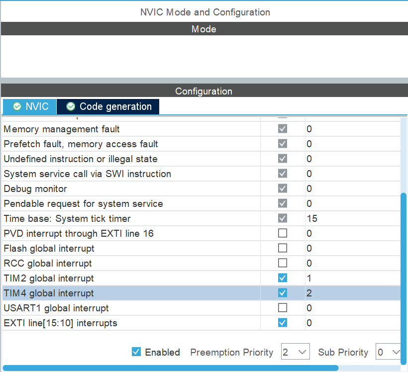

一、工程配置笔记：

芯片型号：STM32F103C8T6

系统时钟：配置为72MHz

开发环境：Makefile+ARM GCC+Vscode

烧录工具：STM32CubeProgrammer+ST-link

二、引脚配置：

PA13 -> SYS_JIMS-SWDIO -> ST-Link调试数据线

PA14 -> SYS_JTCK-SWCLK -> ST-Link调试时钟线

PA10 -> USART1_RX -> 单片机接收端

PA9 -> USART1_TX -> 单片机发送端

PA7 -> GPIO_Output -> 单片机输出引脚（按下按键时翻转）

PA4 -> GPIO_Output -> 单片机输出引脚（定时器每秒翻转）

PB12 -> GPIO_EXTI12 -> 单片机中断输入引脚（按下按键时触发中断）

其余引脚不接线不列出

三、编译与烧录：

编译：终端输入make

连接ST-Link与板子

烧录：终端输入make flash

工程配置如下

中断优先级配置如下（保证按键外部中断优先级最高，其次是TIM2的软件计时(频率更高优先级更高)
再次是TIM4的定时器计时中断，最后是systick）

单片机打印和两种灯的翻转的演示见附件
https://github.com/Happy-19/LightChaser-Training-62/releases/download/v1.0/04_exti_timer.mp4